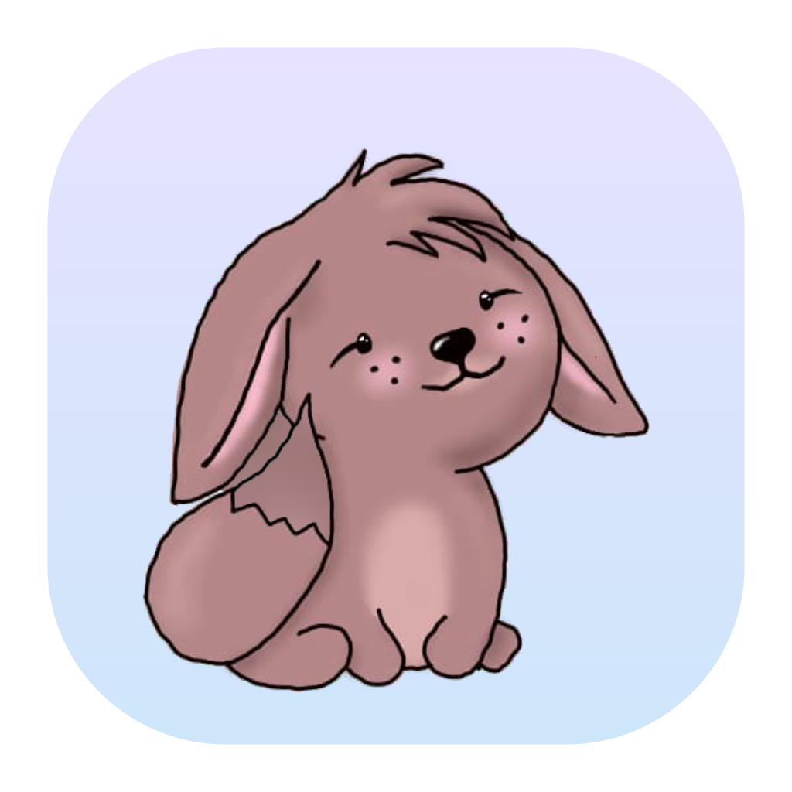
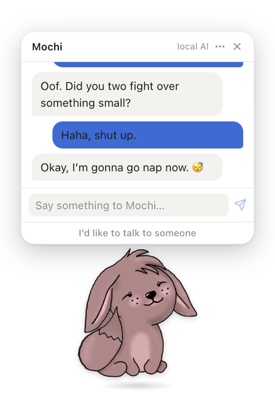
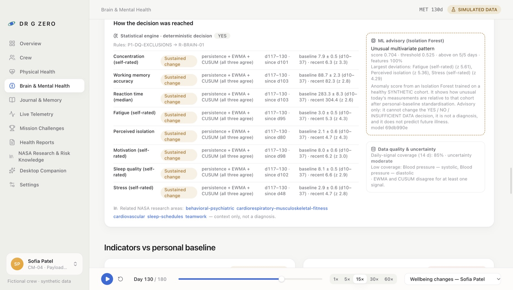
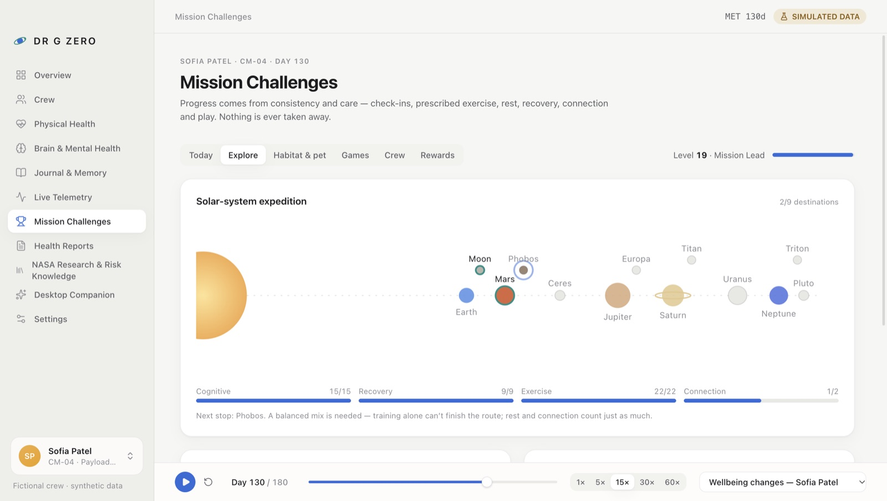
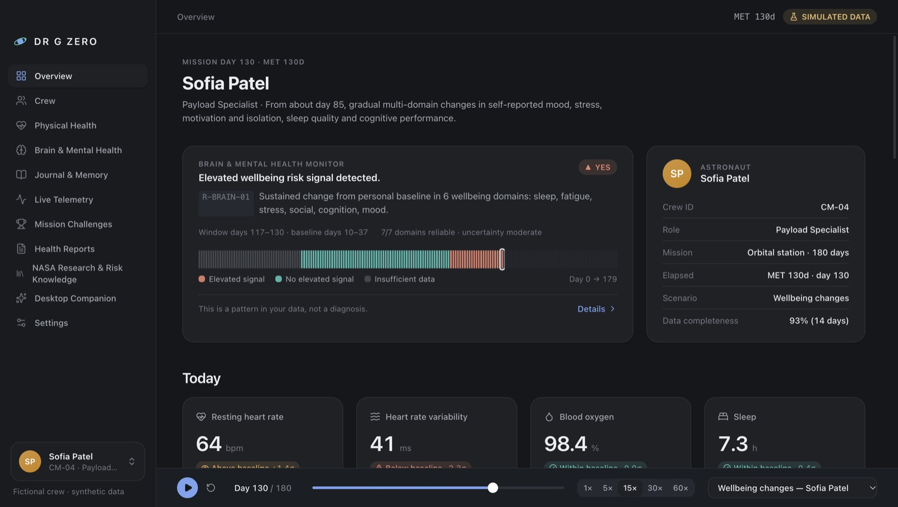

<p align="center"></p>

<h1 align="center">Mochi — A Little More Than a Pet</h1>

<p align="center"><b>A little companion that lives on your desktop, gets to know you, plays with you, helps you reflect, and quietly brings people together.</b></p>

<p align="center"><i>Dr G Zero thinks. Fable connects. Mochi brings it to life.</i></p>

<p align="center">
  <a href="https://khageshvaidya.github.io/mochi-a-little-more-than-a-pet/"><b>Website</b></a> ·
  <a href="https://github.com/KhageshVaidya/mochi-a-little-more-than-a-pet/releases"><b>Download</b></a> ·
  <a href="docs/INSTALLATION.md">Install guide</a> ·
  <a href="presentation/mochi-space-apps.pdf">Presentation</a>
</p>

Built for astronauts on long-duration missions for the NASA Space Apps Challenge 2026 (<i>Create Health Monitoring Software for Astronauts on Space Missions</i>). Mochi is a desktop companion, not another health dashboard: the dashboard is one click behind it.

> ⚠️ **Demonstration software.** Mochi is not a medical device and does not diagnose. All astronaut data in this build is **synthetic** (five fictional crew members) and labelled as such. It is not affiliated with or endorsed by NASA.

## How it fits together

```
MOCHI      → companion and interaction layer: chat, play, journal, memory, suggestions
DR G ZERO  → SCND intelligence: analysis, recommendations and safety (the dashboard)
FABLE      → communication and coordination between companions (planned)
```

Everything runs on your computer. See [docs/ARCHITECTURE.md](docs/ARCHITECTURE.md).

## What it is

| Part | What it does | Status |
|---|---|---|
| **Mochi** | A desktop pet that lives on top of your other windows. Click it to chat. Talks through a **local** model (Ollama + Qwen3 4B, or any Ollama model you choose), never the cloud by default. Private journal and confirmed memories. Opens the dashboard when asked. | Available |
| **Dr G Zero** | The dashboard and the **SCND** engine (Sustained Change, Not Diagnosis). Physical (heart rate, HRV, blood oxygen, sleep, activity) and mental wellbeing (voluntary check-ins) monitoring. Personal baselines, data-quality checks and three agreeing statistical detectors produce **YES / NO / INSUFFICIENT DATA**, with every step explained. Offline, cited NASA Human Research Program risk registry. | Available |
| **Gamification** | Solar-system exploration, habitat building, mini-games, crew missions. Progress comes from taking part; rest is never punished and health metrics are never scores. | Available |
| **Fable** | Companion-to-companion coordination of activities people have agreed to (a puzzle, a meal, a workout). Coordinates activities, not surveillance. | Precursor available (one computer, simulated crewmates); full layer **planned** ([design](docs/fable-architecture.md)) |
| **Synthetic crew** | Five fictional crew members (CM-01 to CM-05) with reproducible 180-day missions covering healthy adaptation, sleep disruption, deconditioning, wellbeing change and incomplete telemetry. | Available |

<table>
<tr>
<td></td>
<td></td>
</tr>
<tr>
<td></td>
<td></td>
</tr>
</table>

## Install

Download the installer for your system from the [Releases page](https://github.com/KhageshVaidya/mochi-a-little-more-than-a-pet/releases) or the [website](https://khageshvaidya.github.io/mochi-a-little-more-than-a-pet/#install).

| | Build | Testing |
|---|---|---|
| macOS 12+ Apple Silicon | `Mochi-<version>-mac-arm64-unsigned.dmg` | CI packaged-app smoke test; tested by hand on an Apple M1 |
| macOS 12+ Intel | `Mochi-<version>-mac-x64-unsigned.dmg` | CI packaged-app smoke test on an Intel runner |
| Windows 10/11 x64 | `Mochi-<version>-win-x64-unsigned.exe` | CI packaged-app smoke test; **not yet tested on a real Windows PC** |

Builds are currently **unsigned**: macOS will ask you to confirm in *System Settings → Privacy & Security*, and Windows SmartScreen will show *More info → Run anyway*. Full steps: [docs/INSTALLATION.md](docs/INSTALLATION.md).

### Local AI (optional, recommended)

Mochi talks through [Ollama](https://ollama.com/download) running on your own computer. On first launch a short guide checks for Ollama, offers to download the model **only after you confirm**, and tests one reply.

| Model | Download | Memory while chatting | Role |
|---|---|---|---|
| `qwen3:4b-instruct-2507-q4_K_M` | ~2.5 GB | ~3.2 GB | Preferred (non-thinking, fast) |
| `qwen3:4b` | ~2.5 GB | similar | Fallback (thinking model, much slower) |

Measured on an Apple M1 with 16 GB RAM: first words after a median 287 ms, a full reply in a median 874 ms ([benchmark](docs/mochi-m1-results.md)). 8 GB RAM is recommended. Without Ollama, Mochi still works in a clearly labelled **simple mode**. No model weights are bundled.

An Anthropic provider exists as an option, **off by default**. Journal entries, health data and SCND results are never sent to it.

## Privacy and safety

- Everything runs and is stored **locally** (SQLite in the app's data folder). There is no account and no telemetry.
- The language model **never** makes or changes a health decision. SCND decisions are deterministic code, and every model reply passes a safety screen and an output guard.
- Mochi does not diagnose depression or any other condition, and there is no hidden emotional monitoring.
- Journal entries are never placed in the model's context and are never shared.
- Fable shares activity intents only, never journals, raw health data or emotional state.

More: [PRIVACY.md](docs/PRIVACY.md) · [privacy and safety design](docs/mochi-privacy-and-safety.md) · [crew wellbeing](docs/privacy-and-crew-wellbeing.md) · [security policy](SECURITY.md).

## How SCND works (in one paragraph)

Each crew member gets a personal baseline (days 10–37) with a robust spread (the larger of SD and 1.4826·MAD). Over a 14-day window, a domain counts as changed only if **persistence** (≥5 of 7 days at z ≥ 1.5), **EWMA** (λ = 0.2, L = 2.7) and **CUSUM** (k = 0.5, h = 5) all agree. A YES needs either two or more core domains, or one strong domain on ≥10 of 14 days at z ≥ 2, confirmed over three days. Missing or unreliable data gives INSUFFICIENT DATA rather than a guess. Full detail: [docs/scnd-technical-explanation.md](docs/scnd-technical-explanation.md).

## Known limitations

- **Unsigned installers** (no Apple Developer ID or Windows code-signing certificate yet): expect a one-time security prompt.
- **Windows** has only been tested automatically in CI, not on a real PC.
- **Ollama is a separate install**; the model download (about 2.5 GB) needs internet once. No model is bundled.
- **Synthetic data only**: no real sensors are connected. SCND thresholds are engineering defaults evaluated on synthetic cohorts, **not clinically validated**. Synthetic results are not clinical evidence.
- **Fable** across separate computers is not implemented yet.
- **Placeholder artwork** for the dog, cat and alien companions (original designs, to be redrawn).

## Develop

Requirements: Node ≥ 22.13, npm. macOS for the full smoke suite.

```bash
npm install
npm run dev        # launch with hot reload (Dr G Zero + desktop companion)
npm run check      # type checks + unit tests
npm run smoke      # build and launch the real app in light and dark, verify security, IPC, storage and UI
cd apps/desktop && MOCHI_ARTIFACT_SUFFIX=-unsigned npm run dist:mac   # build DMGs
```

```
packages/contracts     shared types and zod schemas
packages/signals       signal registry
packages/simulation    five-profile, 180-day synthetic mission generator
packages/data-sources  synthetic / NASA HRP reference adapters
packages/engine        SCND deterministic wellbeing engine
packages/recommendations  recommendation selection and wording rules
packages/gamification  missions, XP, habitat, exploration, co-op goals
packages/companion     conversation router, safety screen, prompt allow-list, output guard
apps/desktop           Electron app (main process, preloads, Dr G Zero and companion renderers)
site/                  GitHub Pages landing page
presentation/          7-slide deck (generated by build-deck.mjs)
```

(The internal package scope is still `@orbital/*`, from the project's earlier name.)

## Documentation

| Topic | Document |
|---|---|
| Installation, first run, uninstall | [INSTALLATION.md](docs/INSTALLATION.md) |
| Privacy | [PRIVACY.md](docs/PRIVACY.md) |
| Troubleshooting | [TROUBLESHOOTING.md](docs/TROUBLESHOOTING.md) |
| Building and releasing | [RELEASING.md](docs/RELEASING.md) |
| Product vision | [mochi-product-vision.md](docs/mochi-product-vision.md) |
| Architecture | [ARCHITECTURE.md](docs/ARCHITECTURE.md) · [mochi-architecture.md](docs/mochi-architecture.md) · [architecture-plan.md](docs/architecture-plan.md) · [decisions.md](docs/decisions.md) |
| SCND engine | [scnd-technical-explanation.md](docs/scnd-technical-explanation.md) · [phase-4-intelligence-design.md](docs/phase-4-intelligence-design.md) · [phase-4-ml-evaluation.md](docs/phase-4-ml-evaluation.md) |
| Fable | [fable-architecture.md](docs/fable-architecture.md) |
| Gamification | [gamification-design.md](docs/gamification-design.md) · [phase-4-adaptive-gamification.md](docs/phase-4-adaptive-gamification.md) |
| Local AI | [mochi-m1-results.md](docs/mochi-m1-results.md) |
| Research and provenance | [research-review.md](docs/research-review.md) · [nasa-hrp-integration.md](docs/nasa-hrp-integration.md) · [github-research.md](docs/github-research.md) |
| Roadmap | [mochi-implementation-roadmap.md](docs/mochi-implementation-roadmap.md) |
| Presentation | [presentation/](presentation/) (7 slides: PPTX, PDF and source) |

## Contributing, licence and credits

- Contributions: [CONTRIBUTING.md](CONTRIBUTING.md) · [Code of Conduct](CODE_OF_CONDUCT.md)
- **Code:** MIT ([LICENSE](LICENSE)). **Mochi artwork:** copyrighted, all rights reserved, not covered by the MIT License ([ASSETS.md](ASSETS.md)). Third-party dependencies: [THIRD_PARTY_NOTICES.md](THIRD_PARTY_NOTICES.md)
- NASA Human Research Program risk descriptions are summarised from public nasa.gov pages, with links; see [nasa-hrp-integration.md](docs/nasa-hrp-integration.md).

*Because looking after astronauts means looking after the humans behind the helmets.*
